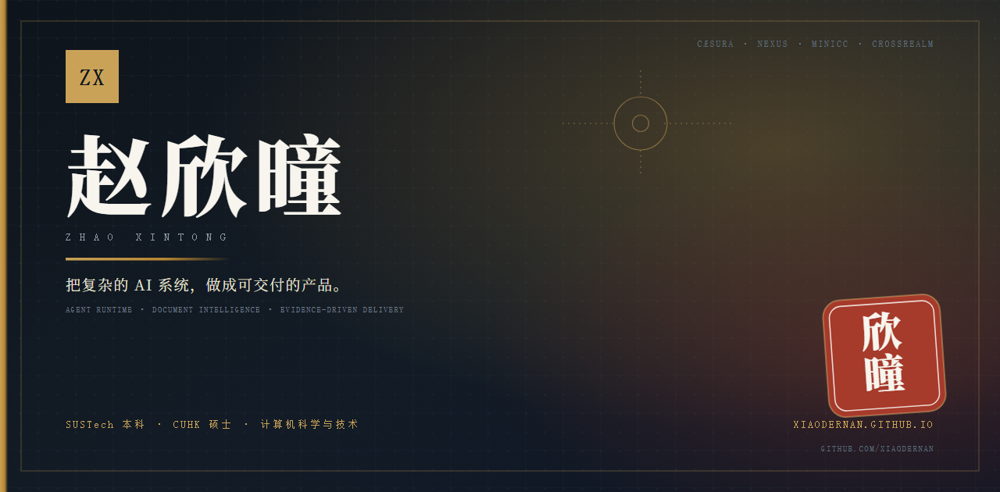

<div align="center">



<h1>赵欣曈 · <a href="https://xiaodernan.github.io/">xiaodernan.github.io</a></h1>

<p>
  <a href="https://xiaodernan.github.io/"><strong>打开个人作品集 →</strong></a>
  &nbsp;&nbsp;·&nbsp;&nbsp;
  <a href="https://yindun.fagougou.com/">隐盾在线系统</a>
  &nbsp;&nbsp;·&nbsp;&nbsp;
  <a href="https://github.com/xiaodernan">@xiaodernan</a>
</p>

<p>
  
  
  
  
</p>

</div>

---

> **一页纸式作品集：没有一处"手抄的数字"。** 本站所有数字（提交数 / 卷数 / 章节数 / 行数）都来自各卫星仓库自己的 `docs/latest.json` 事实包，由 `.github/workflows/sync-*.yml` 周期抓取、直接烘进 HTML —— 页面首屏就是真相，不美化、不掺水。

## 这个页面是什么

`xiaodernan.github.io` 是我的个人展示页与项目总入口：一段 30 秒的自我介绍，六个精选项目卡片（minicc-codex、CÆSURA、NEXUS Content Platform、隐盾、Football OS、AI Career OS），一个实验区（公网可实测的部署），他们的真实 CI 徽章与最新事实，以及按分类过滤的 **16 个公开仓库全量索引**（原创 10 · Fork 4 · 站点 2）。

- **精选作品（01–06）**：每个卡片是一扇可进入的门——部署地址、仓库主页、子栏直达全在卡上
- **实验区（01–04）**：隐盾在线系统、CAESURA、CrossRealm、Football OS —— 都是真跑在公网上的东西
- **全部仓库（16 · 分类过滤）**：亲力亲为的每一份代码都能点过去，分类可筛（原创 / 站点 / 旧版尝试 / Fork 实验）
- **成长路径**：把经历证据按能力线索摆开——Agent Runtime、文档智能、开放世界、确定性模拟、变更验收

## 本地预览

```powershell
python -m http.server 4173
```

然后打开 `http://127.0.0.1:4173/`。

## 身份闸门（fail-closed）

本页载有本人身份信息（姓名 / 院校 / 专业 / 奖项 / 公司 / 产品），这些事实由仓库自带的
`scripts/identity-guard.mjs` 逐条核对。每次改动后运行一次即可：

```powershell
node scripts/identity-guard.mjs
```

脚本要求 index.html 必须包含本人真实信息（姓名、院校、专业、竞赛奖项、实习公司、产品名等），
且不得出现任何往期出错的版本字样。脚本本身是失败即阻断（fail-closed）的闸门；在本仓库
`master` 的每次改动提交前都应先跑一遍，防止身份信息被无意改坏。

> 说明：GitHub 端创建 `.github/workflows/*.yml` 需要 `workflow` 权限，当前 PAT 只有 `repo` 等权限，
> 无法把闸门装进 GitHub Actions。闸门因此以文档化方式 + 本机核对的方式执行。

## 自动同步叙事

每个卫星仓库（specproof、caesura、minicc、football-os、career-os、nexus-platform、nexus-content-platform）的本地 `latest.json` 事实包周期 push 到本仓库对应 assets/<x>/latest.json；展示页直接 fetch。加上 SpecProof 的 `data/specproof-sync.json` + `data/specproof-products.json`（由 weekly `portfolio-sync.yml` 或本人 `gh api` 推送产生）——这三份 remote 文件 `./data/specproof-sync.json` `./data/specproof-products.json` `./data/specproof-latest.md` 已经 fetch 给 `LATEST SHIP SECTION`（见 index.html `<section id="specproof-live">`）。

展示页 SpecProof 板块里那条"ship"行是这么来的：
1. specproof master 上 `docs/latest.json` 被 bot 重锤（CÆSURA/weekly latest-json workflow）
2. `specproof-reference/scripts/sync_portfolio.py` 从 master 现场读 ledger / worldbook / chronicle，写 `artifacts/portfolio-data/{.github-sync.json,latest.md,products.json,.github-sync.json}`
3. 没 token 或 fake token → 只写 artifacts，不推；有效 token → 自动推到 `xiaodernan.github.io@master/data/specproof-sync.json|products.json|latest.md`

本机核验：
```powershell
curl -s https://xiaodernan.github.io/data/specproof-sync.json
curl -s https://xiaodernan.github.io/data/specproof-products.json
curl -s https://xiaodernan.github.io/data/specproof-latest.md
```

## 当前对齐（2026-11-18 收尾）

- 雅思 6.5 · CET6 546（用户本人钦示，强一口气）
- 全部 16 个公开仓库：minicc-codex、specproof、caesura、crossrealm-chronicles、nexus-content-platform、nexus-platform、football-os、football-os-web、ai-career-os、ted、teedyyyy、main、docs(fork sismics-docs)、linuxdo-scripts(fork anghunk-linuxdo-scripts)、xiaodernan(本站)、xiaodernan.github.io
- 4 个私有仓（不在公开清单): fagougou-desensitize、teedyas、teedyassi、teedy-assign
- minicc-codex 现状：提交 1,950 · 批次 483 · Atlas 96 / 58 卷 · 743 测试 · 55,559 行 roadmap（CI 全绿 badge）
- CÆSURA《余响集》62 篇实写（EPIC-VII 实写落地，最新增篇《摆旁的灰》2026-11-18；游戏内双语说明书：手册 + 游记全部 62 篇全文）
- SpecProof：strike #2002 · 203 scrolls · 18 exhibit · Court LOCKED
- IELTS / CET6 已在 `README (profile)`、`banner.svg <desc>`、展示瓷 `index.html` 主要三个 chip 全显示

## 本地核验流程（每次推送后必跑）

```powershell
node scripts/identity-guard.mjs
python -m http.server 4180  # 肉眼复核 hero/轮廓/卡片条
```

## 历史

- `docs/EVIDENCE-identity-baseline-2026-11-18.md` — 本轮身份 restore 全流程记录
- `docs/EVIDENCE-showcase-identity-incident-2026-11-18.md` — 之前影子改写的追溯
- `docs/adr-0275-identity-guard-boundary.md` — identity guard 的职责边界

## 取舍

- `minicc-codex` 是首选主展示项。
- `football-os` 周 cron 自动重算最新事实。
- SpecProof 此刻进入 Strike #1991，展馆门禁仍 LOCKED。
